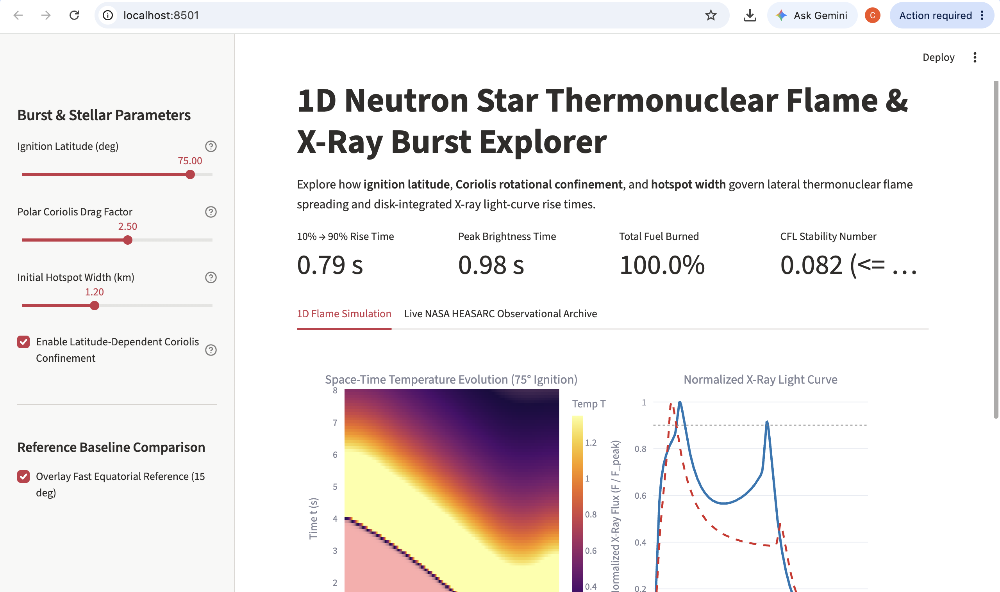
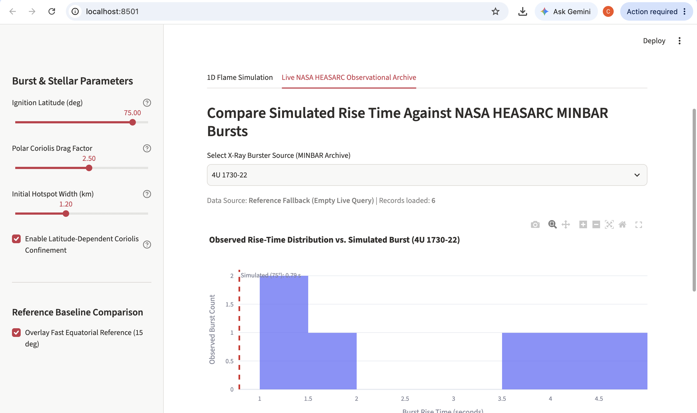

# thermonuclear-ignition-sim-1d

Hi!, this is the code repository for the **1D Thermonuclear Ignition Simulation Model Project** —a modular reaction–diffusion solver and interactive visualization suite exploring how ignition latitude and rotational Coriolis confinement govern lateral flame propagation on accreting neutron stars.

📄 **Project Documentation:** To read the full walkthrough of the physical theory, modelling assumptions, software architecture, worked single-cell calculation, and results, see **[`docs/project_documentation.pdf`](docs/project_documentation.pdf)** (LaTeX source in [`docs/project_documentation.tex`](docs/project_documentation.tex)).

---

## Project Set Up for IDE Code Run 

### 1. Clone & Install Dependencies
```bash
git clone https://github.com<your-username>/thermonuclear-ignition-sim-1d.git
cd thermonuclear-ignition-sim-1d
pip install -r requirements.txt
```

### 2. Launch the Live Interactive & NASA HEASARC Dashboard
Run the Streamlit web application to explore how ignition latitude (\(0^\circ\)–\(85^\circ\)), polar Coriolis drag (\(\alpha\)), and hotspot width affect flame propagation in real time, and compare simulated rise times against live Type-I burst observations from NASA's HEASARC MINBAR archive:
```bash
streamlit run app.py
```
#### Interactive Dashboard Preview

> **[Launch Live Dashboard on Streamlit Cloud](https://thermonuclear-ignition-sim-1d-dtzn3y2hergdr3ncuk6ozv.streamlit.app/)** *(or simply run locally with `streamlit run app.py`)*

| Interactive Simulation & Parameter Explorer | Live NASA HEASARC MINBAR Comparison |
| :---: | :---: |
|  |  |


### 3. Run the Equator vs. High-Latitude comparison graph
Execute the standalone comparison experiment to print rise-time diagnostics and generate the multi-panel diagnostic figure in `outputs/equator_vs_high_latitude_comparison.png`:
```bash
python main.py
```

### 4. Run the Automated Verification Suite
Execute the `pytest` unit and integration suite verifying grid/CFL guards, Arrhenius ignition thresholds, Coriolis diffusivity monotonicity, Neumann boundaries, and physical invariants:
```bash
pytest -v
```

---

## Repository Structure

```text
thermonuclear-ignition-sim-1d/
├── app.py                        # Interactive Streamlit + Plotly dashboard & live HEASARC explorer
├── main.py                       # 15° vs. 75° equatorial-to-polar benchmark runner
├── requirements.txt              # Python dependencies (numpy, matplotlib, streamlit, plotly, requests, pytest)
├── src/
│   ├── config.py                 # Immutable Parameter Object dataclasses & CFL stability validator
│   ├── ignition_process.py       # Strategy interfaces & physics models (Arrhenius, Coriolis drag, Neumann BCs)
│   ├── ignition_calculations.py  # 1D explicit finite-difference PDE solver & t_10->90 rise-time calculator
│   ├── visualisations_builder.py # Publication-ready Matplotlib diagnostic plot generator
│   └── heasarc_client.py         # NASA HEASARC Virtual Observatory TAP (ADQL) MINBAR archive client
├── tests/
│   ├── test_config.py            # Input bounds & CFL stability tests
│   ├── test_ignition_process.py  # Reaction threshold, diffusivity & boundary symmetry tests
│   └── test_ignition_calculations.py # Conservation invariants & physical rise-time tests
├── docs/
│   ├── project_documentation.pdf # Compiled project walkthrough & mathematical documentation
│   ├── project_documentation.tex # LaTeX manuscript source
│   └── references.bib            # BibTeX bibliography
└── outputs/
    └── equator_vs_high_latitude_comparison.png # Generated diagnostic light-curve & heatmap figure
```

---

## Key Scientific & Numerical References

* **Spitkovsky, A., Levin, Y., & Ushomirsky, G. (2002)** — *Propagation of Thermonuclear Flames on Rapidly Rotating Neutron Stars*, ApJ, 566, 1018 (Coriolis confinement scaling $f = 2\Omega\sin\theta$ and planar strip approximation).
* **Bult, P., Altamirano, D., et al. (2022)** — *The Thermonuclear X-Ray Bursts of 4U 1730–22*, ApJ, 940, 81 (Observational benchmark of fast $\sim 1$–$2\,\mathrm{s}$ vs. slow $\sim 4$–$5\,\mathrm{s}$ burst rise times).
* **Galloway, D. K., et al. (2020)** — *The Multi-INstrument Burst ARchive (MINBAR)*, ApJS, 249, 32 (Observational burst catalog queried via NASA HEASARC TAP).
* **Zingale, M.** — [`python-hydro/hydro_examples`](https://github.compython-hydro/hydro_examples) (Numerical inspiration for explicit 1D reaction–diffusion discretization).

